# IAM Lab From Zero To Hero — Setup & User Manual

From an empty PC to a working Identity & Access Management lab: a real Active Directory domain, synced to **your own Entra ID tenant** and **your own Okta org**, with an AI instructor, five portfolio projects (Phase 0 to Phase 5), and a one-click start.

> **About the pictures.** Every screenshot of the platform in this manual was taken from a real, running lab VM. Command output shown in grey boxes is real output from the same lab. Steps inside the Microsoft and Okta web portals are described in words, because those portals change their layout often.

---

## Contents

- [What you are building](#what-you-are-building)
- [Part A — Install the lab (once, about 1–2 hours)](#part-a--install-the-lab-once-about-12-hours)
- [Part B — Daily use: one-click Start and Stop](#part-b--daily-use-one-click-start-and-stop)
- [Part C — Connect your cloud accounts (once)](#part-c--connect-your-cloud-accounts-once)
- [Part D — The course, Phase 0 to Phase 5](#part-d--the-course-phase-0-to-phase-5)
- [Part E — Start over and re-take the lab](#part-e--start-over-and-re-take-the-lab)
- [Part F — Troubleshooting](#part-f--troubleshooting)
- [Part G — Safety rules](#part-g--safety-rules)

---

## What you are building

```
 Your PC (Windows 10/11)
 ├── Desktop icons: "Start IAM Lab" / "Stop IAM Lab"
 └── VirtualBox VM: IAMZ2H-DC01  (Windows Server 2022, internet through NAT)
     ├── Real Active Directory: contoso.lab, ADUC, DNS, PowerShell
     ├── IAM Lab platform: http://localhost:8080 (inside the VM only)
     ├── Lab scripts: C:\IAM\Scripts   (audit logs in C:\IAM\Logs)
     ├── Ollama + llama3.2: the AI Instructor (no GPU needed)
     ├── Microsoft Entra Connect Sync ──► your Entra ID tenant
     └── Okta REST API (token)       ──► your Okta org
```

Two kinds of activity, always labelled on screen:

| Label | Meaning |
|---|---|
| **Simulated output** | Lessons, course labs and workbenches. Nothing is executed. Works anywhere. |
| **Real tool output** | The Real Lab page. Scripts really change Active Directory in the VM, and (through sync and APIs) your own Entra tenant and Okta org. |

---

## Part A — Install the lab (once, about 1–2 hours)

### A1. Check your PC

| Need | Minimum |
|---|---|
| Windows | Windows 10 or 11 (Home is fine) |
| Memory | 14 GB RAM or more (the VM uses 10 GB) |
| Disk | 60 GB free |
| CPU | Virtualisation enabled in the BIOS/UEFI |
| Internet | Needed during the build (downloads Node.js, Microsoft Graph PowerShell, Ollama and a 2 GB AI model) |

> **Tip — slow VM?** If Windows' own hypervisor is on, VirtualBox runs on top of it and gets much slower. Check with `(Get-CimInstance Win32_ComputerSystem).HypervisorPresent` in PowerShell. See [Part F](#part-f--troubleshooting).

### A2. Install VirtualBox

1. Download **VirtualBox 7** for Windows hosts from [virtualbox.org](https://www.virtualbox.org/wiki/Downloads).
2. Run the installer with the default options.

### A3. Download Windows Server 2022 (free evaluation)

1. Go to the [Microsoft Evaluation Center](https://www.microsoft.com/evalcenter/download-windows-server-2022) and download the **ISO** (English, 64-bit).
2. Save it exactly here (create the folders if needed):

```
C:\Users\<you>\Downloads\ADLab-ISOs\WindowsServer2022-Eval.iso
```

The evaluation is free for 180 days.

### A4. Get the project

Download or clone the project folder, for example to `Documents\IAM_LAB_From_ZERO_To_HERO`. Everything below runs from that folder. The code repository is private for now: ask the author for access through the contact form on the [landing page](https://pitchiluxe.github.io/iam-lab-from-zero-to-hero/#contact-title).

### A5. Build the VM (one command)

Open **PowerShell** on your PC, go to the project folder, and run:

```powershell
powershell -ExecutionPolicy Bypass -File .\vm-kit\Build-Lab.ps1
```

What happens (you can watch the VirtualBox window, but do not type in it):

1. Creates the VM `IAMZ2H-DC01` (2 CPUs, 10 GB RAM, 120 GB disk) and installs Windows Server unattended.
2. Promotes it to a domain controller for **contoso.lab** and restarts.
3. Installs Node.js, Microsoft Graph PowerShell and **Ollama** with the `llama3.2` model.
4. Installs the IAM Lab platform and sets it to start automatically.
5. Saves a restore point called **Clean-Start**.

It takes an hour or more. **It can be re-run safely:** if your internet drops, run the same command again and finished steps are skipped. Add `-SkipOllama` to leave out the AI instructor.

### A6. Get the VM password

The VM's Administrator password is generated during the build and stored encrypted for your Windows account. Show it with:

```powershell
powershell -ExecutionPolicy Bypass -File .\vm-kit\Show-LabPassword.ps1
```

### A7. Put the one-click icons on your desktop

```powershell
powershell -ExecutionPolicy Bypass -File .\vm-kit\Install-LabShortcuts.ps1
```

```
Created 'Start IAM Lab' on the desktop and in Start > IAM Lab
Created 'Stop IAM Lab' on the desktop and in Start > IAM Lab
```

From now on you never need to type a command to start or stop the lab.

---

## Part B — Daily use: one-click Start and Stop

### Start

Double-click **Start IAM Lab** on your desktop. A small window shows progress (real output):

```
[22:18:35] VM IAMZ2H-DC01 is running
[22:18:35] Waiting for Windows in the VM (a few minutes after a cold start)
[22:18:51] Windows is up (DC01)
[22:18:51] Waiting for the IAM Lab platform, Active Directory and the sync engine
[22:19:01] Status: platform=True exec=True ad=True sync=Running

The lab is ready.
  1. Go to the VirtualBox window 'IAMZ2H-DC01'.
  2. Sign in as CONTOSO\Administrator (password: vm-kit\Show-LabPassword.ps1).
  3. The IAM Lab opens by itself. If not, double-click 'IAM Lab' on the VM desktop.
When you are done, use 'Stop IAM Lab' so the domain controller shuts down cleanly.
```

From a cold start this takes about 3–5 minutes. Clicking it while the lab is already running is safe: it only checks.

Inside the VM you also have desktop icons for **IAM Lab**, **AD Users and Computers**, **Lab PowerShell** (opens in `C:\IAM\Scripts`) and **Entra Admin Center**.

### Stop

Double-click **Stop IAM Lab**. It asks Windows in the VM to shut down properly.

> **Why not just close the window?** A domain controller keeps databases (Active Directory, the sync engine) that a hard power-off can damage. Always use **Stop IAM Lab**.

### The platform

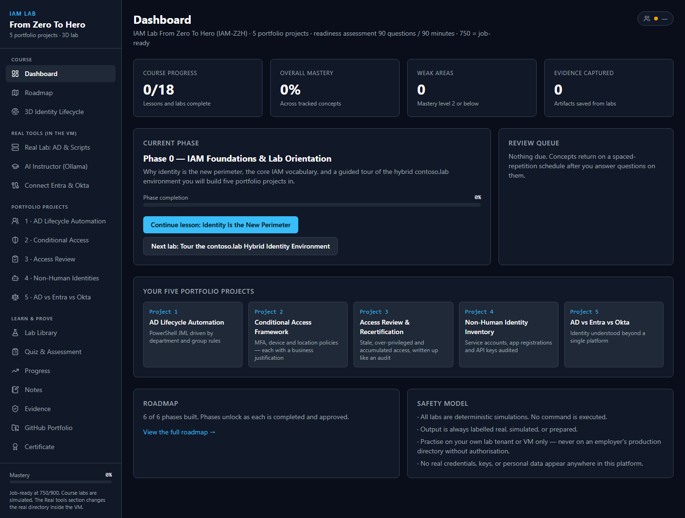

The left menu has four groups:

| Group | Pages |
|---|---|
| **Course** | Dashboard, Roadmap, 3D Identity Lifecycle |
| **Real tools (in the VM)** | Real Lab, AI Instructor, Connect Entra & Okta |
| **Portfolio projects** | One workbench per project, 1 to 5 |
| **Learn & prove** | Lab Library, Quiz, Progress, Notes, Evidence, GitHub Portfolio, Certificate |

---

## Part C — Connect your cloud accounts (once)

You can do Phases 0–5 with simulations only. Connecting **your own** Entra tenant and Okta org makes Phases 1, 3, 4 and 5 run for real across three platforms. Use **free lab accounts only — never an employer's**.

The **Connect Entra & Okta** page in the platform lists the same steps and shows live status badges:

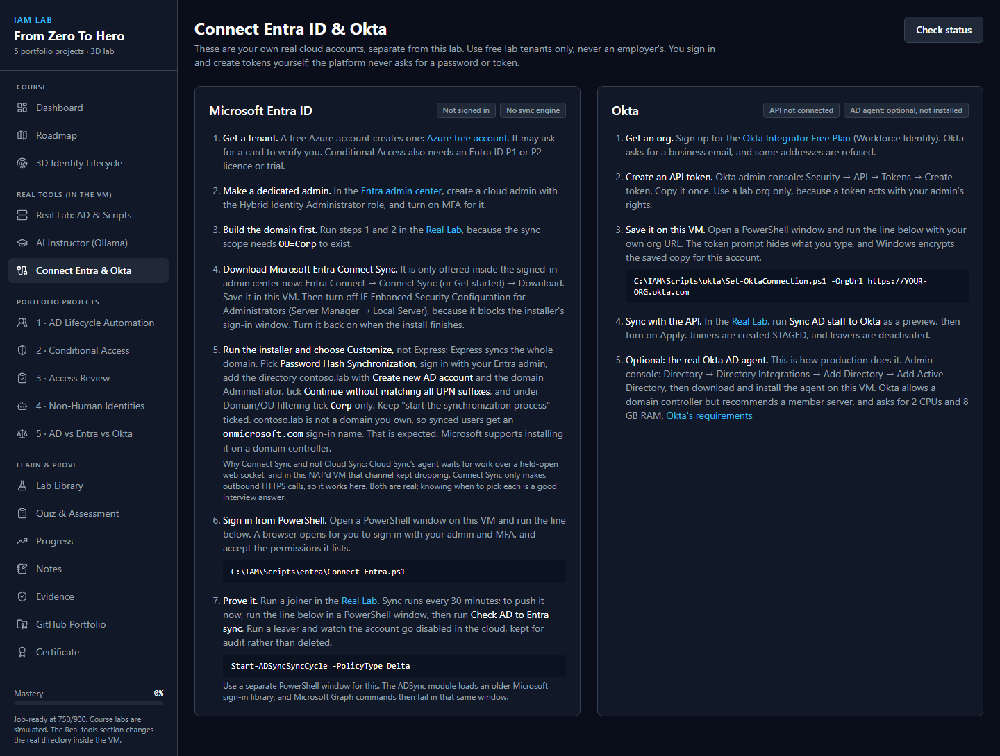

### C1. Build the domain first

The sync scope needs `OU=Corp` to exist. In the **Real Lab**, run steps **1 · Build AD** (both buttons) before connecting Entra. See [Phase 1](#phase-1--ad-lab-with-automated-user-lifecycle).

### C2. Entra ID tenant and admin

1. Create a free tenant (a free Azure account creates one).
2. In the [Entra admin center](https://entra.microsoft.com), create a cloud admin for the lab and turn on MFA for it.

### C3. Sign in from the VM

In the VM, open **Lab PowerShell** and run:

```powershell
C:\IAM\Scripts\entra\Connect-Entra.ps1
```

A browser opens; sign in with your lab admin and MFA and accept the permissions it lists. The script saves an encrypted sign-in for this VM account, so lab scripts can use Microsoft Graph without asking again.

### C4. Install Microsoft Entra Connect Sync (AD → Entra)

1. In the Entra admin center: **Entra Connect → Connect Sync** (or **Get started**) → **Download**. Save it in the VM.
2. In the VM, turn **IE Enhanced Security Configuration** off for Administrators (*Server Manager → Local Server*). It blocks the installer's sign-in window. Turn it back on afterwards.
3. Run the installer and choose **Customize** (not Express — Express syncs the whole domain):
   - **User sign-in:** *Password Hash Synchronization*
   - **Connect to Microsoft Entra ID:** sign in with your lab admin
   - **Connect your directories:** `contoso.lab` → *Add Directory* → *Create new AD account* → `CONTOSO\Administrator`
   - **Microsoft Entra sign-in:** tick *Continue without matching all UPN suffixes to verified domains*
   - **Domain/OU filtering:** *Sync selected domains and OUs* → untick everything → tick only **Corp**
   - Keep *Start the synchronization process* ticked → **Install**
4. Synced users appear as `name@<yourtenant>.onmicrosoft.com`, because `contoso.lab` is not a domain you own. That is expected.

> **Why Connect Sync and not Cloud Sync?** Cloud Sync's agent receives work over a held-open web socket; inside this NAT'd VM that channel kept failing about 7.5 minutes after every start. Connect Sync only makes outbound HTTPS calls, so it works here. Knowing when to choose each is a common interview question.

Check it from the Real Lab with **Check AD to Entra sync** (real output):

```
Tenant: <your tenant>  syncEnabled=True  lastSync=11/10/2026 01:21:13
SYNCED   mchen          -> mchen@<tenant>.onmicrosoft.com  cloudEnabled=True
SYNCED   jreyes         -> jreyes@<tenant>.onmicrosoft.com  cloudEnabled=True
SYNCED   pshah          -> pshah@<tenant>.onmicrosoft.com  cloudEnabled=False
...
```

Sync runs every 30 minutes. To push it now, open a **separate** PowerShell window in the VM:

```powershell
Start-ADSyncSyncCycle -PolicyType Delta
```

### C5. Okta org and API token

1. Sign up for the **Okta Integrator Free Plan** (Workforce Identity) at [developer.okta.com/signup](https://developer.okta.com/signup/). Choose the role *Other developers exploring APIs and SDKs*.
   - Okta refuses free email providers such as Gmail and Outlook.com. Use an address on a domain you own.
2. In the Okta Admin Console (the address ending in `-admin.okta.com`): **Security → API → Tokens → Create token**. Name it `IAM-Lab-VM`, keep *Any IP*, and copy it. It is shown only once.
3. In the VM, in **Lab PowerShell**, run with **your org URL — the one without `-admin`**:

```powershell
C:\IAM\Scripts\okta\Set-OktaConnection.ps1 -OrgUrl https://integrator-1234567.okta.com
```

4. Paste the token at the hidden prompt (right-click pastes). Success looks like:

```
Connected to Okta org: <your org name> (https://integrator-1234567.okta.com)
```

The token is encrypted with Windows DPAPI for the VM's Administrator account and never passes through the web page.

---

## Part D — The course, Phase 0 to Phase 5

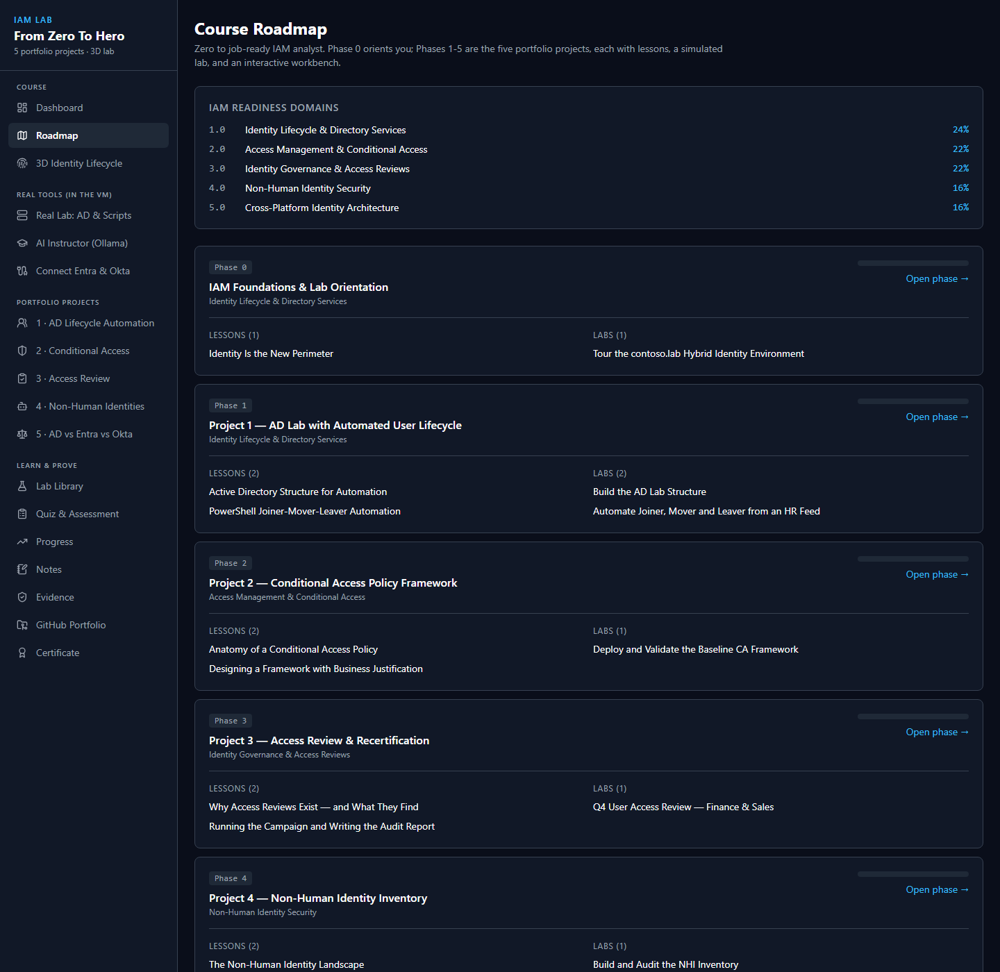

Every phase follows the same loop: **lesson → simulated lab → workbench → (real lab) → quiz → evidence**.

- **Lessons** open from the Roadmap or the Dashboard's *Continue lesson* button.
- **Simulated labs** (Lab Library) have a safe terminal that only understands the lab's commands, an expected-results panel and evidence capture.
- **Workbenches** are interactive tools that export a report to your **Evidence** locker.
- **Real Lab** steps run on the real domain controller.

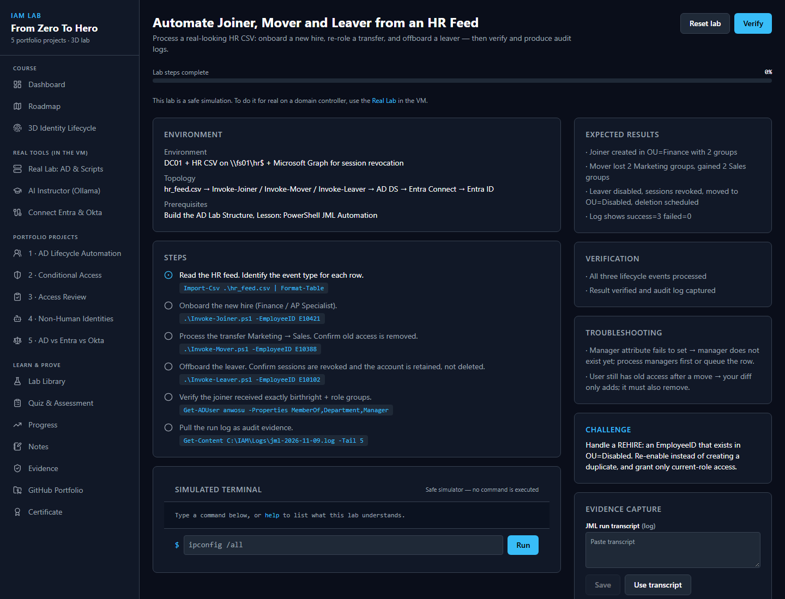

### The Real Lab page

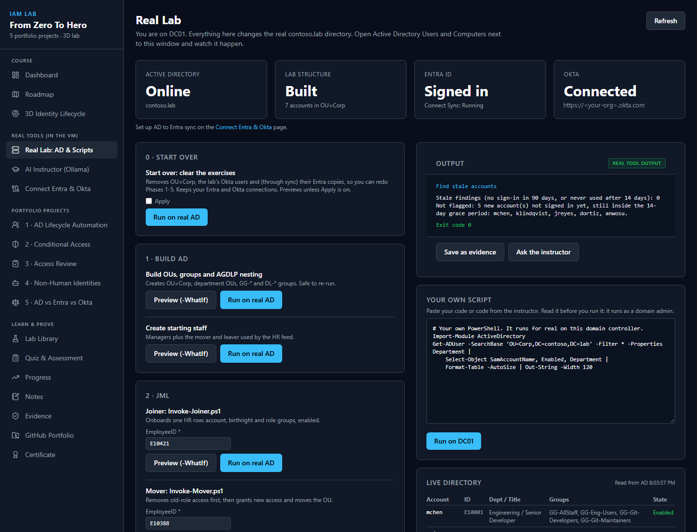

- **Status tiles** show Active Directory, the lab structure, Entra (and whether Connect Sync is running) and Okta, read live from the VM.
- **Script catalog**, grouped by phase. Scripts that change things have **Preview (-WhatIf)** — always preview first — and **Run on real AD**.
- **Output** streams the real PowerShell output. **Save as evidence** stores it; **Ask the instructor** sends it to the AI Instructor for an explanation.
- **Your own script** runs any PowerShell you paste. Risky patterns (deleting objects, downloads, encoded commands) need a tick to confirm, and **code from the AI Instructor always needs the tick**.
- **Live directory** lists the accounts in `OU=Corp`.

### Phase 0 — IAM Foundations & Lab Orientation

**Goal:** understand why identity is the new perimeter, the IAM vocabulary (AAA, JML, least privilege), and tour the hybrid `contoso.lab` environment.

1. Dashboard → **Continue lesson: Identity Is the New Perimeter**.
2. Open **3D Identity Lifecycle** to see a person's journey from HR record to deprovisioning.
3. Do the lab **Tour the contoso.lab Hybrid Identity Environment**.
4. Take the Phase 0 quiz.

### Phase 1 — AD Lab with Automated User Lifecycle

**Goal:** build an AD structure for automation and run real Joiner-Mover-Leaver (JML) from an HR feed, driven by department and group rules.

**Workbench:** *1 · AD Lifecycle Automation* (JML Automation Console).

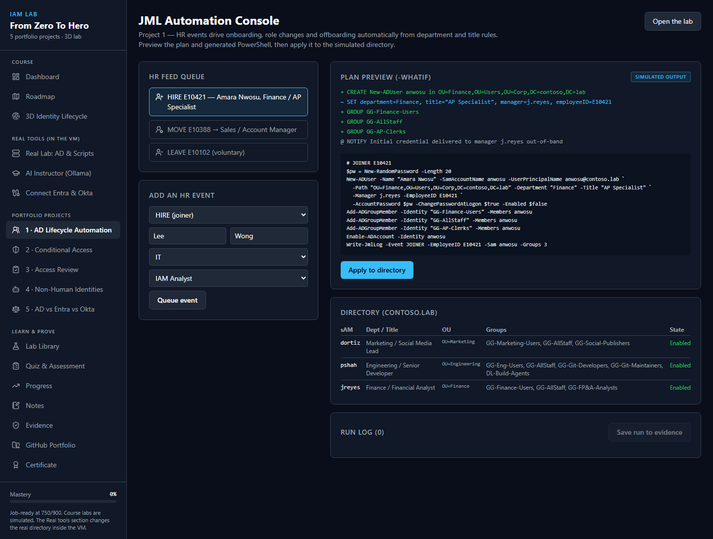

**Real Lab steps, in order** (preview each, then run):

| Step | Real Lab button | What it does |
|---|---|---|
| 1 | **Build OUs, groups and AGDLP nesting** | Creates `OU=Corp`, department OUs, `GG-*` global and `DL-*` domain-local groups, AGDLP nesting. Safe to re-run. |
| 2 | **Create starting staff** | Creates the managers plus the mover and leaver used by the HR feed |
| 3 | **Joiner** `E10421` | Onboards Amara Nwosu (Finance, AP Specialist) |
| 4 | **Mover** `E10388` | Moves Daniel Ortiz from Marketing to Sales: removes old access **first**, then grants new |
| 5 | **Leaver** `E10102` | Offboards Priya Shah: disable, reset password, revoke cloud sessions, record and remove groups, move to `OU=Disabled` |

Real output of the three events:

```
[HIRE] E10421  run=8adc495c  operations=5
  OK   Create
  OK   AddGroup GG-Finance-Users
  OK   AddGroup GG-AllStaff
  OK   AddGroup GG-AP-Clerks
  OK   Enable anwosu
VERIFIED from AD: sam=anwosu enabled=True ou=OU=Finance,OU=Users,OU=Corp,DC=contoso,DC=lab

[MOVE] E10388  run=4f354034  operations=6
  OK   RemoveGroup GG-Marketing-Users
  OK   RemoveGroup GG-Social-Publishers
  OK   Move OU=Sales,OU=Users,OU=Corp,DC=contoso,DC=lab
  OK   SetAttributes
  OK   AddGroup GG-Sales-Users
  OK   AddGroup GG-Account-Managers

[LEAVE] E10102  run=cab508fa  operations=9
  OK   Disable pshah
  OK   ResetPassword pshah
  OK   RevokeCloudSessions pshah
  OK   RecordGroups GG-Git-Maintainers;GG-Git-Developers;GG-Eng-Users;GG-AllStaff
  OK   RemoveGroup GG-AllStaff
  ...
  OK   Move OU=Disabled,OU=Corp,DC=contoso,DC=lab
VERIFIED from AD: sam=pshah enabled=False ou=OU=Disabled,OU=Corp,DC=contoso,DC=lab
```

**If Entra and Okta are connected**, finish the cross-platform loop:

1. Push to Entra (separate PowerShell window): `Start-ADSyncSyncCycle -PolicyType Delta`, then **Check AD to Entra sync**. The joiner appears, the mover's department changes, and the leaver shows `cloudEnabled=False` — disabled and kept for audit, not deleted.
2. **Sync AD staff to Okta**: preview, then tick **Apply**. Real output:

```
AD accounts: 7  Okta users: 1  actions: 6
[+] created mchen@contoso.lab status=STAGED
[+] created anwosu@contoso.lab status=STAGED
...
```

New Okta users are created **STAGED** (they exist but cannot sign in, and no activation email is sent). Leavers are **deactivated**.

Every run is written to the audit log `C:\IAM\Logs\jml-<date>.log`.

### Phase 2 — Conditional Access Policy Framework

**Goal:** design an Entra ID Conditional Access framework (MFA, device compliance, location, risk) with a **business justification for every policy**, and test it with *What If* before enforcing anything.

**Workbench:** *2 · Conditional Access* (Conditional Access Designer).

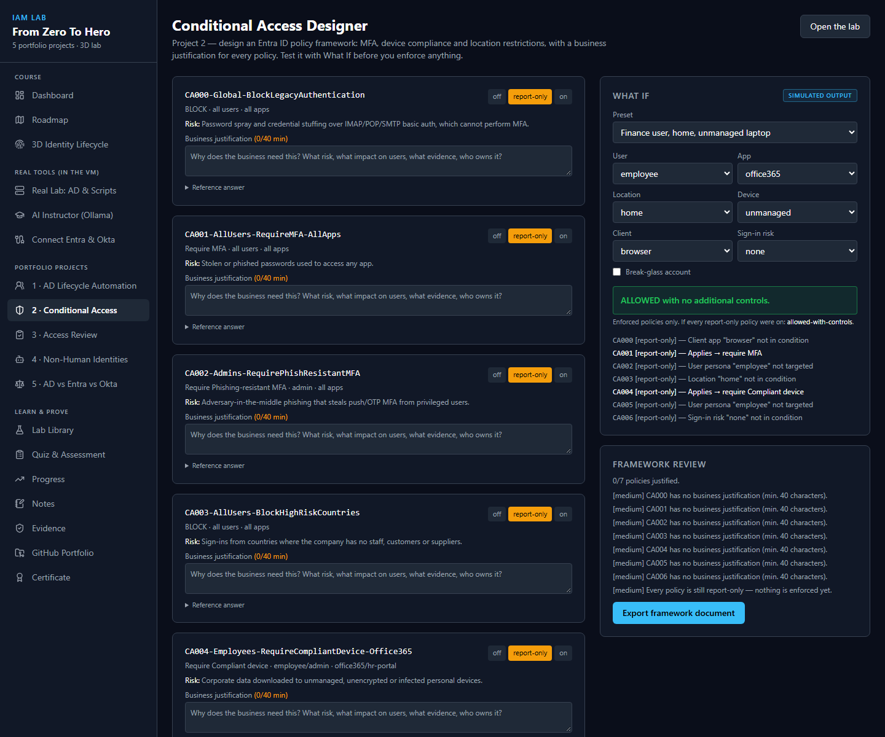

1. For each policy, write a justification (40+ characters): what risk, what impact on users, what evidence, who owns it.
2. Use **What If** to test personas, apps, locations, devices and sign-in risk.
3. Read the **Framework review**, then **Export framework document** to Evidence.

**Real deployment (optional, needs a licence).** Conditional Access needs **Entra ID P1 or P2** — even report-only. In the Real Lab, **Deploy CA baseline** always previews first and refuses to apply until all of these pass:

- a **break-glass group** (cloud-only security group) holding a separate **Global Administrator** emergency account;
- at least **two** Global Administrators;
- **Security Defaults** turned **off** (they cannot run together with Conditional Access);
- an **active P1/P2** licence.

It creates CA000, CA001, CA004 and CA006 as **report-only** and **CA002-Admins-RequireMFA as enforced**, because once Security Defaults is off nothing else makes admins use MFA. Without a licence, do Phase 2 in the workbench and keep the guarded preview output as evidence.

> **Licences that do *not* help:** *Microsoft Entra ID Governance* is an add-on that needs P1/P2 underneath; it does not unlock Conditional Access. Each tenant gets one Entra ID P2 trial.

### Phase 3 — Access Review & Recertification

**Goal:** find stale accounts, over-privileged users, role accumulation and SoD conflicts, and document them like an audit.

**Workbench:** *3 · Access Review*.

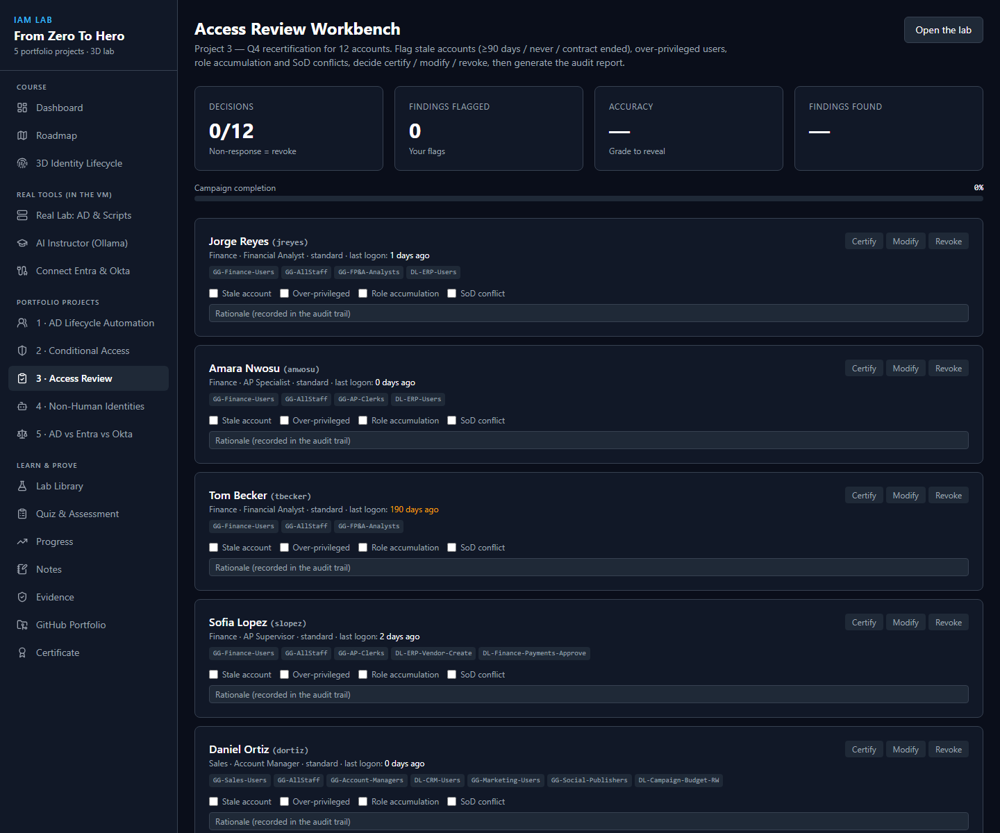

**Real Lab:** **Find stale accounts** and **List privileged group members**. New accounts get a 14-day grace period, so a new hire is not flagged on day one (real output):

```
Stale findings (no sign-in in 90 days, or never used after 14 days): 0
Not flagged: 5 new account(s) not signed in yet, still inside the 14-day grace period: mchen, klindqvist, jreyes, dortiz, anwosu.
```

Save both outputs as evidence and write the findings into the workbench's audit report.

### Phase 4 — Non-Human Identity Inventory

**Goal:** inventory service accounts, gMSAs, app registrations and API keys; audit rotation, permissions, ownership, and whether each is still needed.

**Workbench:** *4 · Non-Human Identities* (NHI Inventory Auditor).

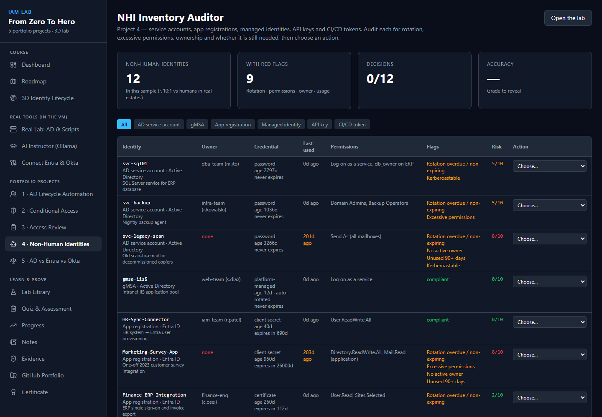

**Real Lab:** **Non-human identity inventory** reads AD SPN accounts, gMSAs and (if Entra is connected) app registrations with credential metadata. Real findings from a lab that tried Cloud Sync first and then switched:

```
== Group Managed Service Accounts
provAgentgMSA     True     <- left behind by the abandoned Cloud Sync agent: orphaned
ADSyncMSA48f2e    True     <- used by Connect Sync: keep
== Entra app registrations (credential metadata only)
contoso.lab  owners=0      <- no owner: classic audit finding
```

### Phase 5 — Cross-Platform Comparison: AD vs Entra vs Okta

**Goal:** compare user creation, MFA and lifecycle across the three platforms, using the same people.

**Workbench:** *5 · AD vs Entra vs Okta*.

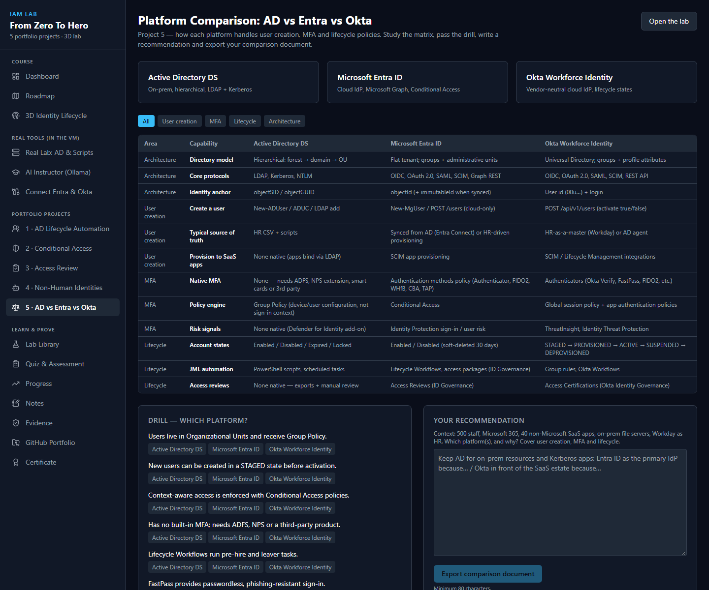

With everything connected, one leaver reaches all three platforms (real result):

| Platform | After the leaver |
|---|---|
| **AD** | Disabled, in `OU=Disabled`, groups removed and recorded in the description |
| **Entra ID** | Disabled after sync; sessions revoked before the sync ran; kept for audit |
| **Okta** | `DEPROVISIONED` |

Use **Check Okta connection** to see each user's Okta lifecycle state (`STAGED`, `ACTIVE`, `DEPROVISIONED`).

### Prove it: quiz, evidence and portfolio

| Page | Use it for |
|---|---|
| **Quiz & Assessment** | Phase quizzes and the 90-question readiness assessment (750/900 = job-ready) |
| **Evidence** | Everything you saved from labs, workbenches and real runs |
| **GitHub Portfolio** | Turns your evidence into project READMEs |
| **Certificate** | Completion certificate |

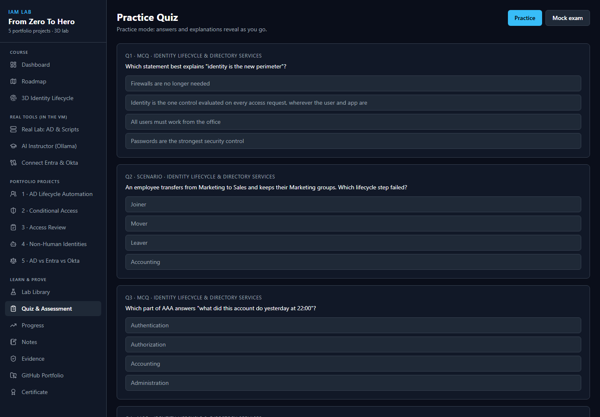

### The AI Instructor

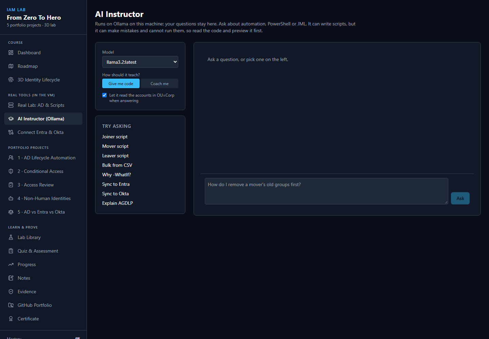

Runs on Ollama inside the VM; your questions stay there. Choose **Give me code** or **Coach me**, and optionally let it read the accounts in `OU=Corp`. Code it writes opens in the Real Lab's script box, where you must read it and tick the confirmation before it can run.

---

## Part E — Start over and re-take the lab

You can redo Phases 1–5 as many times as you like **without reconnecting Entra or Okta**.

### E1. Start over (recommended)

In the **Real Lab**, card **0 · Start over → Start over: clear the exercises**:

1. Click **Run on real AD** with *Apply* **unticked** to preview. Real preview output:

```
[START OVER] PREVIEW  run=b918ff27  domain=contoso.lab
  Okta: 6 lab user(s) to remove; your admin and other users are kept
    [preview] remove mchen@contoso.lab (STAGED)
    ...
  AD: remove OU=Corp,DC=contoso,DC=lab with 7 user(s), 22 group(s), 11 OU(s)
  Entra: after the AD removal, Connect Sync deletes the synced copies (they stay in the recycle bin 30 days)
Preview only. Kept either way: Entra sign-in, Okta token, Connect Sync, Ollama, platform, audit logs.
```

2. Tick **Apply** and run it again. It takes under a minute. Real output:

```
[START OVER] APPLY  run=a8fa1791  domain=contoso.lab
  Okta: 6 lab user(s) to remove; your admin and other users are kept
    [-] removed mchen@contoso.lab
    ...
  AD: remove OU=Corp,DC=contoso,DC=lab with 7 user(s), 22 group(s), 11 OU(s)
    [-] removed OU=Corp,DC=contoso,DC=lab
  Entra: Connect Sync delta run started (exit 0); cloud copies disappear within a few minutes
Done. Kept: Entra sign-in, Okta token, Connect Sync, Ollama, platform, audit logs.
```

When you rebuild, Connect Sync creates **new** Entra users with the same sign-in names. The old ones stay in the Entra recycle bin under renamed sign-in names (`<id>name@...`), so they never clash, and Entra purges them after 30 days.

> **Tip:** if you rebuild and run the leaver straight away, it reports *Cloud sessions NOT revoked (user not synced)*. That is correct: the user does not exist in Entra until the next sync. The AD side of the leaver still completes.

| Removed | Kept |
|---|---|
| `OU=Corp` and everything in it (staff, groups, OUs) | Your Entra sign-in and your Okta token |
| The lab's Okta users (logins `@contoso.lab`) | Connect Sync and its settings |
| Their Entra copies (Connect Sync removes them; 30 days in the recycle bin) | Ollama, the platform, the audit logs |

Then start again at Phase 1 with **Build OUs, groups and AGDLP nesting**.

To also reset your **course progress** (lessons, quizzes, mastery), use **Progress → Reset all progress**. That only clears your browser's saved progress.

### E2. Restore points (whole-VM rewind)

For a full rewind of the VM, run on your **PC** (not in the VM), from the project folder:

```powershell
powershell -ExecutionPolicy Bypass -File .\vm-kit\Reset-Lab.ps1 -Snapshot <name>
```

| Restore point | Holds |
|---|---|
| `Ready-Empty` | Empty domain. **No** cloud connections or Connect Sync |
| `Clean-Start` | What a fresh build saves |

A restore point keeps whatever was signed in when it was taken, but **does not roll back Entra or Okta**. Prefer **Start over** (E1) for re-takes; use restore points for repairs.

**Save your own restore point** once Entra and Okta are connected, so a repair never costs you the connections:

```powershell
powershell -ExecutionPolicy Bypass -File .\vm-kit\Save-LabPoint.ps1 -Name Connected
```

Later, `Reset-Lab.ps1 -Snapshot Connected` brings back a VM that is still connected.

### E3. Keeping the connections alive

| Connection | Expires | Fix |
|---|---|---|
| Entra sign-in (Graph) | After about 90 days **without use** | Run `Connect-Entra.ps1` again |
| Okta API token | After 30 days **without use** | Create a new token, run `Set-OktaConnection.ps1` again |
| Windows Server evaluation | 180 days | Rebuild, or extend the evaluation |

Using the lab at least once a month keeps both cloud connections alive.

---

## Part F — Troubleshooting

| Symptom | Cause | Fix |
|---|---|---|
| VM very slow | Windows hypervisor is on under VirtualBox | Your choice (WSL2/Docker need it): turn off Memory integrity, *Virtual Machine Platform* and *Windows Hypervisor Platform*, run `bcdedit /set hypervisorlaunchtype off`, restart |
| VM froze (clock stopped, no response) | Host overload | VirtualBox → *Machine → Close → Power off*, then **Start IAM Lab**. The kit uses 2 CPUs to reduce this |
| vm-kit scripts fail with `VERR_DUPLICATE` or `Closing guest session ... VERR_TIMEOUT` | After many hours of uptime, VirtualBox's helper in the VM stops closing its sessions | Run `vm-kit\Repair-LabGuestControl.ps1` on your PC, or restart the VM from its own Start menu |
| Start IAM Lab: "platform did not answer" | Platform task not started | Run `vm-kit\Update-Platform.ps1` on your PC, click Start again |
| Real Lab tiles say "Checking…" for a while | The VM is still starting services | Wait a minute and click **Refresh** |
| Entra sign-in error **530035** | Security Defaults blocks the device-code sign-in | Use `Connect-Entra.ps1` (browser sign-in), as in C3 |
| "You'll need the Internet" during sign-in | Windows thinks the DC has no internet | Use `Connect-Entra.ps1`, which avoids that sign-in window |
| Connect Sync installer sign-in window is blank or blocked | IE Enhanced Security Configuration | Turn it off for Administrators during the install, then back on |
| `RefreshCacheAsync ... does not have an implementation` | ADSync and Microsoft Graph loaded in the same PowerShell window | Run ADSync commands in their own window |
| Okta signup refuses your email | Okta blocks free email providers | Use an address on a domain you own |
| `Okta is not connected` | Token not saved in the VM | Run `Set-OktaConnection.ps1` **inside the VM** (not on your PC) |
| `The argument '.\vm-kit\Reset-Lab.ps1' ... does not exist` | Ran a PC script inside the VM | `vm-kit\*.ps1` run on your PC; `C:\IAM\Scripts\*` run in the VM |
| CA deploy: "No active Entra ID P1 or P2 licence" | Trial expired or never started | Buy P1 for one user, or use an E5 trial; or keep Phase 2 simulated |

---

## Part G — Safety rules

- The platform listens on `127.0.0.1` inside the VM; nothing outside the VM can reach it.
- Lab scripts refuse to run unless the domain is `contoso.lab`, and refuse accounts outside `OU=Corp` or protected admin accounts.
- Scripts that change Entra or Okta **preview** unless you turn **Apply** on.
- Sign-ins and API tokens never pass through the web page; they are encrypted with Windows DPAPI for the VM's Administrator account.
- Scripts run as a domain admin because this is an isolated lab. Real automation should use a gMSA with only the rights it needs — the course teaches this.
- Use lab tenants only, never an employer's.
